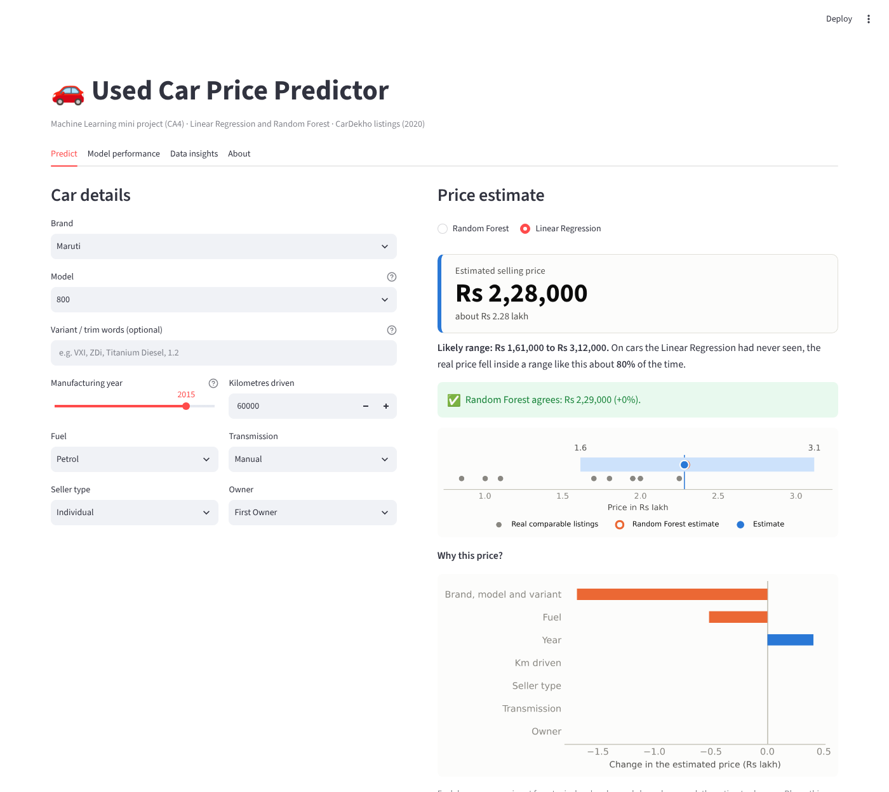
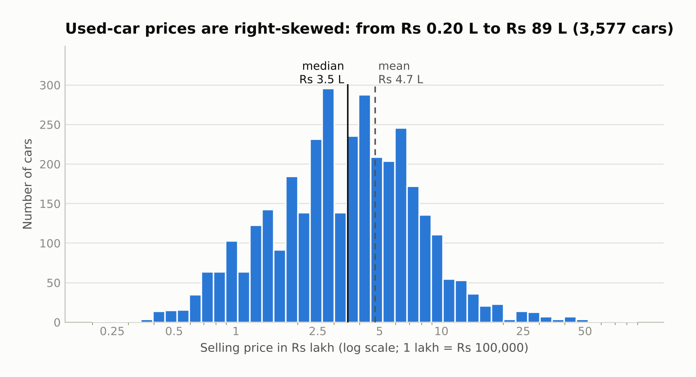
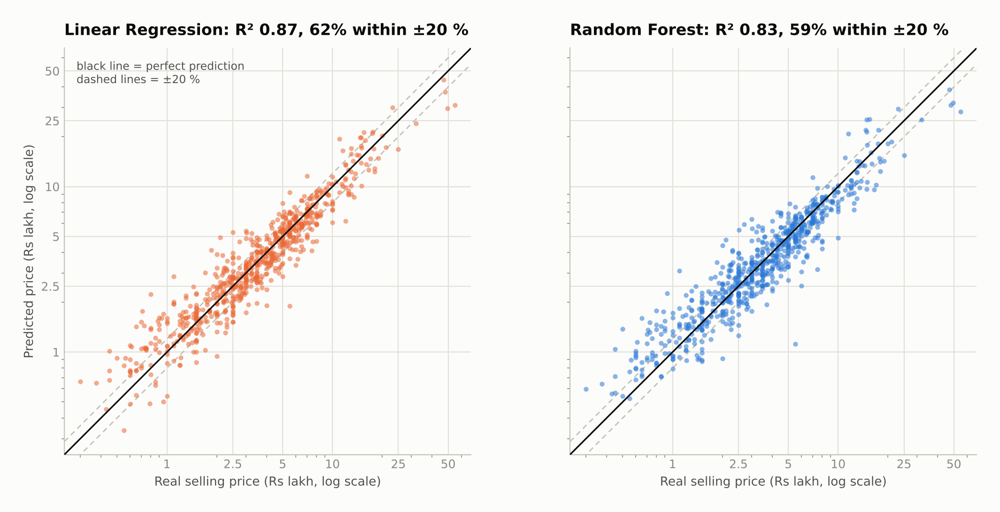
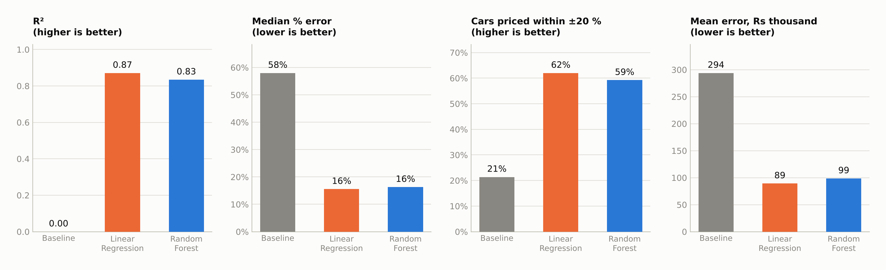
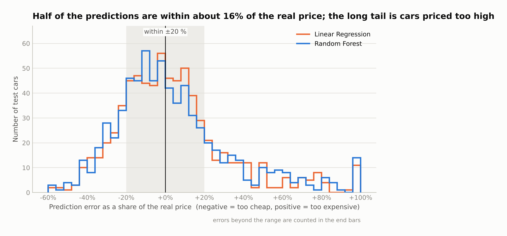
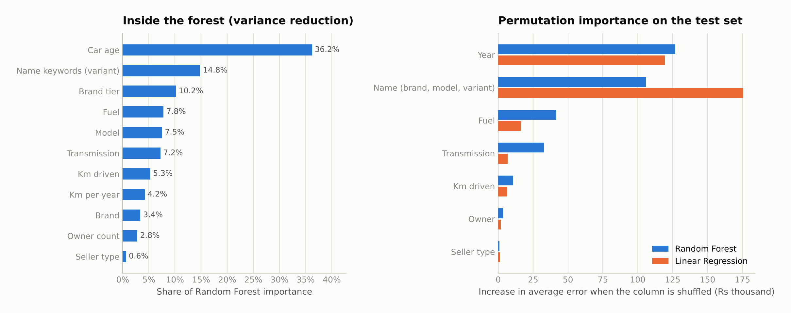

# Used Car Price Prediction

**Predicting the exact selling price (in rupees) of a used car with Linear Regression and Random Forest, on CarDekho listings** · Machine Learning mini project (CA4)
TY DS, University Dept. of ICT, MGM University · AY 2026-27

[](https://colab.research.google.com/github/AbdulRafe8869/used-car-price-band-prediction/blob/main/notebooks/Used_Car_Price_Prediction.ipynb)


Give the project a used car's brand, model, variant, year, kilometres driven, fuel, transmission, seller type and owner history, and it
returns the **estimated selling price in rupees**, for example *Rs 5,30,000*, plus a **likely price range** (about -29% / +37%) so that
the estimate is not mistaken for a guarantee. A Streamlit web app lets you try it live.



## Headline results (716 held-out test cars)

| Model | R² | Mean error (MAE) | Typical error (median % error) | Within ±10% of real price | Within ±20% of real price |
|---|---|---|---|---|---|
| Average-price baseline | 0.000 | Rs 2,93,893 | 58.0% | 10.1% | 21.4% |
| **Linear Regression** (Ridge, on log price) | **0.871** | **Rs 89,212** | **15.5%** | **33.2%** | **62.0%** |
| Random Forest (on log price) | 0.834 | Rs 98,562 | 16.3% | 31.7% | 59.2% |

* **A typical prediction is about 15-16% away from the real price**, and 6 out of 10 cars are priced within ±20%. The "likely range" contains the real
  price for 80.4% of test cars (target 80%).
* Linear Regression is **slightly ahead** of Random Forest, and the lead is real for R² (95% bootstrap interval of the gap -0.067 to -0.008) and MAE
  (Rs 3,100 to Rs 15,800 better), but not for median % error. We therefore do **not** claim that Random Forest wins. Random Forest also overfits
  more (R² 0.95 on training data vs 0.83 on test data).
* Where it struggles: **cars above Rs 10 lakh** (few examples, median error 21%) and **very cheap cars** (small rupee error, but 21% in relative terms).
  Misses are mostly cars whose condition the 7 inputs cannot see (for example a 2012 BMW X1 listed at Rs 7 lakh that the model prices at about Rs 11.5 lakh).
* **Limitation to know first:** the data are 2020 listings. On a second, pricier CarDekho file (v4, median Rs 8.25 lakh vs Rs 3.5 lakh) both models
  **under-price by about 10-14%**, because the market has shifted. See the bonus experiments.

## How this repo maps to the marking scheme (10 marks)

| # | Parameter (2 marks each) | Where to look |
|---|---|---|
| 1 | Dataset description and understanding | [Dataset](#1-dataset) below · notebook Part 1 · `reports/figures/01-04` |
| 2 | Data preprocessing and preparation | [Preprocessing](#2-preprocessing) below · notebook Part 2 · `src/data_prep.py`, `src/features.py`, `src/pipeline.py` |
| 3 | ML model implementation | [Models](#3-models) below · notebook Part 3 · `src/pipeline.py`, `src/train.py` |
| 4 | Model performance and evaluation | [Results](#4-results-and-interpretation) below · notebook Part 4 · `src/evaluate.py`, `reports/` |
| 5 | Live demonstration, team contribution and viva | [Run the app](#running-the-project) · [Team](#team-and-contributions) · [`docs/VIVA_GUIDE.md`](docs/VIVA_GUIDE.md) |

## 1. Dataset

| | |
|---|---|
| **Source** | Kaggle, [*Vehicle dataset from CarDekho*](https://www.kaggle.com/datasets/nehalbirla/vehicle-dataset-from-cardekho) by `nehalbirla` (`data/raw/CAR_DETAILS_FROM_CAR_DEKHO.csv`) |
| **Purpose** | Used-car listings from CarDekho (India) with the seller's asking price |
| **Size** | 4,340 records, 8 columns (7 inputs + 1 target) |
| **Target** | `selling_price`, the exact price in rupees (a **regression** problem) |
| **Data types** | Numeric: `year`, `km_driven`, `selling_price` · Categorical: `fuel`, `seller_type`, `transmission`, `owner` · Text: `name` |

| Column | Meaning |
|---|---|
| `name` | Listing title: brand + model + variant, e.g. "Maruti Swift Dzire VDI" |
| `year` | Year of manufacture |
| `selling_price` | **Target.** Listing price in rupees |
| `km_driven` | Odometer reading in km |
| `fuel` | Petrol, Diesel, CNG, LPG, Electric |
| `seller_type` | Individual, Dealer, Trustmark Dealer |
| `transmission` | Manual or Automatic |
| `owner` | First, Second, Third, Fourth & Above owner, or Test Drive Car |

**Target distribution** (3,577 clean cars): minimum Rs 20,000, median Rs 3.5 lakh, mean Rs 4.74 lakh, maximum Rs 89 lakh. Prices are strongly right-skewed
(skewness 5.5), so the models learn **log(price)**, which is almost symmetric (skewness -0.02), and the answer is converted back to rupees. We tested this choice:
without the log, Linear Regression's median error rises from 15.5% to 24.6% and it predicts negative prices for 38 test cars.



## 2. Preprocessing

The order is deliberate: **clean, split, and let everything that learns from data live inside one scikit-learn `Pipeline`**, so nothing from the test set leaks into training.

| Step | What we did | Result |
|---|---|---|
| Missing values | Checked every column. Median / most-frequent imputers sit inside the pipeline as a safety net | 0 missing values |
| Duplicates | Removed exact duplicate rows **before** splitting (otherwise copies land in both train and test and inflate the score) | 763 removed (17.6%), 3,577 remain |
| Irrelevant / impossible values | Checked for non-positive price or distance and impossible years | none found; no column dropped (`name` is converted into features) |
| Outliers | Numeric features are clipped at Q3 + 3 x IQR (fences learned on training data only). The **price itself is not clipped**: luxury cars are real | a 806,599 km typing error no longer distorts the scaler |
| Feature engineering | `car_age` (2020 minus year), `km_per_year`, `owner_count`, `brand`, `model`, `brand_tier` (our own Economy / Mid-range / Luxury grouping), and `name_keywords` (variant words such as "vdi", "titanium") | 4 numeric + 6 categorical + keyword flags |
| Encoding | One-hot encoding; levels seen fewer than 10 times are pooled, and unseen levels at prediction time are handled | hundreds of model columns |
| Scaling | `StandardScaler` on numeric features (needed by Linear Regression; harmless for Random Forest) | mean 0, std 1 |
| Target transform | `log(price)` for training, `exp()` for the answer (`TransformedTargetRegressor`) | prices always come out in rupees |
| Feature selection | Drop-one-group ablation (cross-validated on the training set) and permutation importance | identity (brand/model) and age/usage carry the model |
| Train / test split | 80:20, `random_state=42`, balanced by price decile so train and test have the same price spread | 2,861 train / 716 test |

## 3. Models

| | Linear Regression (Ridge) | Random Forest Regressor |
|---|---|---|
| **Idea** | Price = weighted sum of the features (on the log scale); an L2 penalty keeps the weights small and stable | Many decision trees, each on a random sample of cars and features; the average of their answers is the price |
| **Why** | Simple, interpretable, strong baseline | Captures non-linear effects; used in most of the 2025 papers we reviewed |
| **Tuned** | `alpha` (8 values) | `n_estimators`, `max_depth`, `min_samples_leaf`, `max_features` (24 settings) |
| **Chosen** | `alpha = 1` | 400 trees, no depth limit, `min_samples_leaf = 1`, `max_features = 0.33` |

Both are tuned with **Grid Search and 5-fold cross-validation on the training set only**, scored by RMSLE (error on the log price), and compared with an
average-price dummy baseline. The test set is touched once, for the final numbers.

## 4. Results and interpretation





* **Both models are far above the baseline** (R² 0.87 / 0.83 vs 0.00; median error 16% vs 58%).
* **What drives the price:** car identity (brand, model, variant) and year dominate, then fuel and transmission. Removing identity raises the cross-validated median error
  from 15% to about 28-30%; removing age and usage raises it to about 23-24%.
* **Errors by price range** (Linear Regression, median % error): below Rs 2.5 L 21%, Rs 2.5-5 L 14%, Rs 5-10 L 11%, above Rs 10 L 21%.
  Cheap cars are hard in relative terms (a Rs 20,000 error is large on a Rs 1 lakh car); the few luxury cars are hard because there are few to learn from.
* **Slight bias:** the long error tail is on the *too expensive* side; the median error is about 0% for Linear Regression.



**Did the model perform satisfactorily?** Yes for a classroom-scale tool: R² 0.87 and a typical error of about 15%. It is not a valuation tool, which is why the
app always shows a likely range.

### Limitations and possible improvements

* **2020 prices only**; the demo cannot price newer cars or today's market. Car age is measured against 2020.
* **Only 7 inputs.** No condition, accident history, colour, location or service record.
* **Listing prices**, not confirmed sale prices.
* **Brand tiers are our own judgement** (listed in `src/config.py`).
* **Random Forest overfits** on 3,577 rows; more data would help it more than Linear Regression.
* **Shifted markets:** on the pricier v4 file, R² drops to 0.38 (Linear) / 0.30 (Random Forest) and both models under-price by 10-14% (bonus experiment).
* Ideas: condition and location features, gradient boosting, fresh dated listings.

### Bonus experiments (beyond the rubric)

`python -m src.experiments` runs four extras, saved in `reports/experiments.json`: a feature-group ablation; a test of richer specifications (engine, power, mileage, seats)
on the larger v3 file, which gives a **small but real gain of about 1 point of % error** (95% interval excludes zero); an external check on the v4 file (above);
and a **log-price vs raw-price** comparison that justifies the log target for Linear Regression (Random Forest is about equal either way).

## Running the project

**Option A: Google Colab (no installation).** Click the Colab badge at the top. Run the first cell, then **Runtime > Run all** (about 10 minutes).

**Option B: your computer.** Python 3.11 to 3.14 (3.13 recommended).

```bash
git clone https://github.com/AbdulRafe8869/used-car-price-band-prediction.git
cd used-car-price-band-prediction
python -m venv .venv
.venv\Scripts\activate            # Windows   (macOS/Linux: source .venv/bin/activate)
pip install -r requirements.txt

streamlit run app/streamlit_app.py      # live demo, uses the saved models in models/
python -m pytest -q                     # 19 quick checks (no data leakage, prices in rupees, app starts)
python -m src.run_all                   # retrain everything and regenerate all reports and figures (about 10-20 min)
```

The trained models, metrics and figures are committed, so the app works immediately after cloning. If scikit-learn complains
about a version mismatch, run `python -m src.train` to rebuild the models for your installation.

**Free web deployment (optional).** On [share.streamlit.io](https://share.streamlit.io) choose *New app*, select this repository and set the main file to `app/streamlit_app.py`.

## Repository structure

```
├── README.md
├── requirements.txt / requirements-lock.txt
├── data/raw/                CarDekho CSVs (main file + v3 and v4 used by the bonus experiments)
├── src/
│   ├── config.py            every constant, grid and column list in one place
│   ├── data_prep.py         load, clean, split (balanced by price decile)
│   ├── features.py          feature engineering and outlier clipping (scikit-learn transformers)
│   ├── pipeline.py          preprocessing + regressors (log-price target)
│   ├── train.py             Grid Search with 5-fold CV, likely-range calibration, saves models
│   ├── evaluate.py          test-set metrics, bootstrap intervals, importances
│   ├── experiments.py       bonus experiments
│   ├── visualize.py         chart style (colour-blind-safe palette) and every figure
│   ├── make_figures.py      regenerates reports/figures
│   ├── predict.py           price estimate, likely range and "what moved the price" explanation used by the app
│   └── run_all.py           one command for the whole project
├── app/streamlit_app.py     live demo
├── notebooks/Used_Car_Price_Prediction.ipynb   Colab-ready walkthrough of all five marking parts
├── models/                  saved pipelines (Linear Regression, Random Forest, baseline) + metadata
├── reports/                 metrics.json, experiments.json, CV tables, figures/
├── docs/VIVA_GUIDE.md       student-wise responsibilities, demo script and viva Q&A
├── scripts/set_github_user.py
└── tests/                   pytest checks
```

## Team and contributions

Guide: **Ms. Priyanka Hajare**

| Student | Roll no. | Responsibility |
|---|---|---|
| **Student 1** · Abdul Rafe | 2407070 | Dataset description and preprocessing (`data_prep.py`, `features.py`, notebook Parts 1-2) |
| **Student 2** · Muntasir Ali Khan | 2407019 | ML model implementation (`pipeline.py`, `train.py`, notebook Part 3) |
| **Student 3** · Shaikh Abdullah Saud | 2407040 | Model evaluation, results and overall demonstration (`evaluate.py`, `app/`, notebook Parts 4-5) |

## References

1. "Smart Pricing Solutions for Used Cars Using Decision Tree and Random Forest Model," *J. Theoretical and Applied Information Technology*, vol. 103, no. 9, May 2025.
2. "Comparative Analysis of Machine Learning Models for Predicting Used Car Prices," *IRJMETS*, Feb. 2025.
3. "An Accurate Prediction of Used Car Price Using Random Forest and Decision Tree Regressor," *IJCRT*, vol. 13, no. 7, Jul. 2025.
4. T. Li, "Used Car Price Prediction and Feature Importance Analysis Using XGBoost and SHAP," *Highlights in Business, Economics and Management*, vol. 65, 2025.
5. "Prediction of Car Prices in Nigeria Using Machine Learning Models," *J. Engineering Research*, Univ. of Lagos, Sep. 2025.
6. I. Fayyaz, G. G. M. N. Ali, S. S. Khairunnesa, "Advanced Feature Engineering and ML Techniques for High Accurate Price Prediction of Heterogeneous Pre-Own Cars," *Vehicles*, 7(3), 94, 2025. doi:10.3390/vehicles7030094
7. nehalbirla, "Vehicle dataset from CarDekho," Kaggle.

## License and data

The code is released under the MIT License (see `LICENSE`). The CarDekho data belongs to its original publisher and is included only so the project runs
out of the box for coursework; check the terms on its Kaggle page before reusing it elsewhere.
